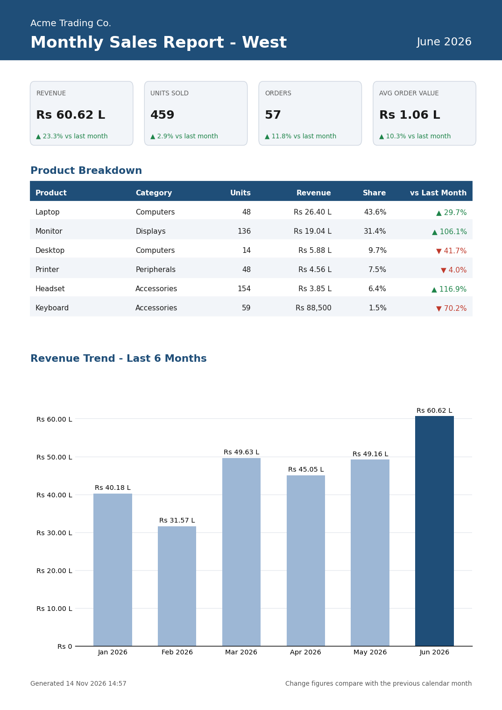

# Automated Report Generator (Python)

Turn raw transaction data into polished one-page PDF reports, one per region, with KPIs, a product breakdown and a trend chart. This is the Python rebuild of my [VBA Report Generator](https://github.com/Swami529796/excel-report-generator).


---

## The Problem

Month-end reporting often looks like this: filter the data for each region, build a pivot, copy the numbers into a template, update a chart, save it as PDF and repeat for every region. Done by hand it is repetitive, slow and easy to get wrong.

## The Solution

```bash
python generate_reports.py --month 2026-06
```

For every region in the data, the script:

1. Calculates the KPIs and compares them with the previous month
2. Builds the product table, sorted by revenue
3. Draws a 6-month revenue trend
4. Saves a one-page A4 PDF
5. Writes a `run_log.csv` listing what was created or skipped

## Sample Output



The sample dataset has 1,217 transactions from January to June 2026 across four regions. Running it for June 2026 creates four PDFs in about 3 seconds:

```
Reports/
├── Sales Report - East - 2026-06.pdf
├── Sales Report - North - 2026-06.pdf
├── Sales Report - South - 2026-06.pdf
├── Sales Report - West - 2026-06.pdf
└── run_log.csv
```

## Features

| Feature | Details |
|---|---|
| 📊 KPI tiles | Revenue, units, orders and average order value, each with % change vs last month (green/red) |
| 📦 Product breakdown | Units, revenue, share of total and month-on-month change |
| 📈 Trend chart | Revenue for the last 6 months, with the report month highlighted |
| 📄 PDF export | One A4 page per region, drawn directly with Matplotlib (no Excel or Word needed) |
| 🧾 Run log | Each region is recorded as Created or Skipped, with a reason |
| ✅ Input checks | Stops with a clear message if a required column is missing |

## VBA vs Python

| | [VBA version](https://github.com/Swami529796/excel-report-generator) | Python version |
|---|---|---|
| Runs from | A button inside Excel | The command line, or a scheduled task |
| Report layout | Built on a worksheet, exported to PDF | Drawn straight to PDF with Matplotlib |
| Outlook drafts | Yes | Not yet (on the roadmap) |
| Settings | A sheet in the workbook | Command-line options |
| Best for | Teams who want to tweak the layout in Excel | Unattended runs and larger datasets |

## How to Use

```bash
pip install -r requirements.txt
```

```bash
python generate_reports.py --month 2026-06 --company "My Company Ltd" --regions North East
```

| Option | Default | Description |
|---|---|---|
| `--month` | (required) | Report month as `YYYY-MM` |
| `--data` | `data/sales_data.csv` | Input file |
| `--company` | `Acme Trading Co.` | Name shown at the top of each report |
| `--output` | `Reports` | Folder for the PDFs |
| `--regions` | all | Only these regions |
| `--png` | off | Also save a PNG copy of each report |

**Data layout expected:**

| Date | Region | Product | Category | Units | Unit Price | Revenue |
|---|---|---|---|---|---|---|

To rebuild the sample data, run `python make_sample_data.py`.

## Project Structure

```
python-report-generator/
├── generate_reports.py     # the report generator
├── make_sample_data.py     # creates the repeatable sample dataset
├── data/
│   └── sales_data.csv      # sample data
├── images/                 # screenshot for this README
├── requirements.txt
├── README.md
└── LICENSE
```

## Roadmap

- [ ] Outlook drafts with the PDF attached, as in the VBA version
- [ ] Combined all-regions summary page
- [ ] Read settings and the distribution list from a config file

---

**Author:** [Swaminathan Narayanan](https://www.linkedin.com/in/swaminathan-narayanan-9781a7154/): Data Analytics | Excel & VBA Automation | Python | SQL | Power BI
